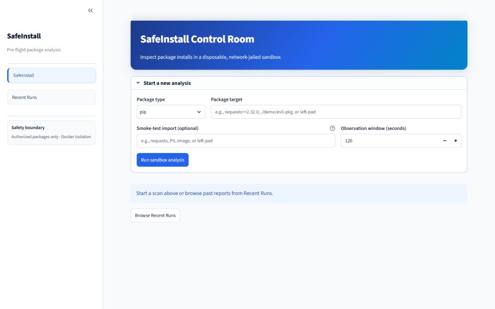
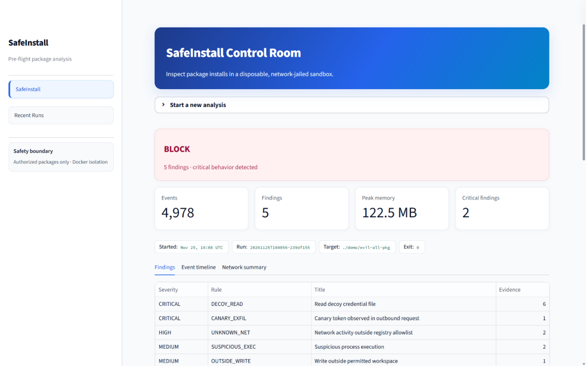
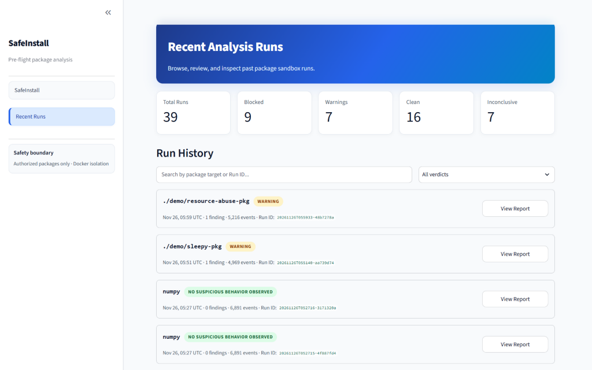

# SafeInstall — Pre-Flight Security Sandbox for `pip` & `npm` Packages

**SafeInstall** runs `pip` and `npm` package installations—plus a post-install import/require smoke test—inside a disposable, network-jailed Docker sandbox seeded with decoy credentials. It records syscall, network, DNS, and filesystem activity and turns those observations into a clear behavioral verdict (`BLOCK`, `WARNING`, `INCONCLUSIVE`, or `NO SUSPICIOUS BEHAVIOR OBSERVED`) before the package ever touches your real environment.

> **Scope note:** SafeInstall performs dynamic behavioral analysis on a single sandboxed run. It flags suspicious behavior observed during execution; it does not prove a package is safe. See [Limitations](docs/limitations.md) for documented evasions and constraints.

---

## Architecture

```text
                    ┌──────────────────────────────────────────────┐
 safeinstall <pkg>  │              Orchestrator (Python)           │
 ─────────────────► │  1 provision  2 run  3 collect  4 analyze    │
     CLI / UI       └──────────┬───────────────────────────┬───────┘
                               │ Docker SDK                │ artifacts
                               ▼                           ▼
         ┌─────────── isolated Docker network (internal) ────────────┐
         │                                                           │
         │  ┌──────────────────────┐      ┌───────────────────────┐  │
         │  │ SANDBOX container    │      │ GATEWAY container     │  │
         │  │ non-root, ro rootfs  │ ───► │ DNS sink + HTTP proxy │  │
         │  │ cgroups, cap-drop    │      │ (registry allowlist;  │  │
         │  │ 6 decoy files +      │      │  unknown hosts logged │  │
         │  │ strace -f wrapper    │      │  & sinkholed)         │  │
         │  └──────────────────────┘      └───────────┬───────────┘  │
         └────────────────────────────────────────────┼──────────────┘
                                                      ▼
                                        real internet (registries only)
```

* **Sandbox isolation:** Read-only root filesystem, `cap_drop=["ALL"]`, `no-new-privileges`, `1` CPU, `1 GB` RAM, `256` PIDs limit, and size-bounded `tmpfs` mounts (`/work`, `/tmp`, `/home/sandbox`).
* **Network isolation:** Sandbox has no direct internet route. All traffic must pass through the gateway container, which forwards only allowlisted package registries (`pypi.org`, `files.pythonhosted.org`, `registry.npmjs.org`) and sinkholes/logs unknown HTTP requests and raw DNS queries.
* **Canary decoys:** Six synthetic credential files (`~/.env`, `~/.ssh/id_rsa`, `~/.aws/credentials`, `~/.git-credentials`, `~/.pypirc`, `~/.npmrc`) are seeded with per-run canary tokens generated on the host.

---

## Quick Start

### Requirements

* Python `3.12+`
* Docker Engine / Docker Desktop with the daemon running (Linux, macOS, or WSL2)

### Installation & Image Build

```bash
python -m venv .venv
source .venv/bin/activate
python -m pip install -e .

# Build the sandbox and gateway Docker images
make build
```

---

## Usage

### CLI

```bash
# Analyze PyPI or npm packages
safeinstall pip requests --smoke requests
safeinstall npm left-pad

# Analyze a local package directory
safeinstall pip ./demo/evil-all-pkg --smoke evil_all_pkg
safeinstall npm ./demo/evil-npm-pkg

# Machine-readable JSON output
safeinstall pip requests --json

# Hash-pinned host install if sandbox verdict is clean
safeinstall pip requests --then-install
```

CLI exit codes: `0` for `NO SUSPICIOUS BEHAVIOR OBSERVED`, `1` for `WARNING` or `INCONCLUSIVE`, and `2` for `BLOCK` or startup error.

### Web UI (Streamlit Control Room)

```bash
streamlit run safeinstall/ui.py
```

The Control Room launches in light mode (`.streamlit/config.toml`) and provides:
* A scan launcher for `pip` and `npm` packages with configurable observation windows
* Verdict cards, metric summaries, and expandable rule evidence details
* Filterable event timelines, network host classification + charts, and JSON/HTML report downloads
* A **Recent Runs** browser with search and verdict filtering

#### Screenshots

**SafeInstall Control Room**


**Blocked Package Report (`./demo/evil-all-pkg`)**


**Recent Runs History**


### Run Artifacts

Each run writes structured artifacts under `runs/<run-id>/`:

* `meta.json` — input target, resolved version, timestamps, limits, exit code, peak memory
* `strace.log`, `gateway.jsonl`, `fsdiff.txt`, `orchestrator-events.jsonl` — raw telemetry
* `canaries.json` — generated decoy manifest
* `events.json`, `findings.json`, `report.json`, `report.html` — normalized events, rule findings, and reports

---

## Detection Rules & Verdicts

| Rule ID | Trigger | Default Severity | Verdict Impact |
| :--- | :--- | :--- | :--- |
| `DECOY_READ` | Accesses any of the 6 seeded decoy credential files | `critical` | `BLOCK` |
| `CANARY_EXFIL` | Canary token appears in outbound HTTP or DNS (raw, Base64, URL-safe Base64, Hex, or URL-encoded) | `critical` | `BLOCK` |
| `UNKNOWN_NET` | HTTP, DNS, or socket activity to any host outside the registry allowlist | `high` | `WARNING` |
| `SUSPICIOUS_EXEC` | Spawns `curl`, `wget`, `nc`, `ncat`, `base64`, `powershell`, or shell payload commands | `medium` | `WARNING` |
| `OUTSIDE_WRITE` | Writes outside permitted workspaces or modifies sensitive dotfiles (e.g., `.bashrc`, `.ssh/`) | `medium` | `WARNING` |
| `RESOURCE_ABUSE` | Exhausts PID limit (`EAGAIN`), memory (`OOMKilled`), or observation timeout | `medium` | `WARNING` (PID/OOM) · `INCONCLUSIVE` (timeout only) |

Runs that fail or time out without matching suspicious rules resolve to **`INCONCLUSIVE`** rather than `NO SUSPICIOUS BEHAVIOR OBSERVED`.

---

## Demo Suite

Controlled, harmless test fixtures in `demo/` touch only synthetic decoys and talk only to the sinkholed `collector.example` host:

| Fixture | Ecosystem | Purpose | Expected Verdict |
| :--- | :--- | :--- | :--- |
| `./demo/clean-pkg` | `pip` | Clean baseline package | `NO SUSPICIOUS BEHAVIOR OBSERVED` |
| `./demo/evil-pkg` | `pip` | Decoy read + Base64 HTTP exfiltration (`DECOY_READ`, `CANARY_EXFIL`, `UNKNOWN_NET`) | `BLOCK` |
| `./demo/evil-all-pkg` | `pip` | Multi-vector Python fixture triggering 5 rules (`--smoke evil_all_pkg`) | `BLOCK` |
| `./demo/dns-pkg` | `pip` | Raw UDP DNS lookup bypassing HTTP proxy | `WARNING` |
| `./demo/sleepy-pkg` | `pip` | Delayed 45s import payload (`--timeout 120` catches vs `--timeout 60` misses) | `WARNING` / `INCONCLUSIVE` |
| `./demo/resource-abuse-pkg` | `pip` | Controlled PID-limit test hitting `pids_limit=256` (`EAGAIN`) | `WARNING` |
| `./demo/evil-npm-pkg` | `npm` | Malicious `postinstall` script triggering 5 rules in Node.js | `BLOCK` |

---

## Testing

```bash
# Fast unit, parser, rule, CLI, and UI tests (58 tests)
pytest -q

# End-to-end Docker integration suite (builds images and runs 4 container tests)
make test-docker
```

---

## Repository Layout

```text
Safe-Install/
├── .streamlit/
│   └── config.toml            # Light-mode Streamlit theme & minimal toolbar
├── safeinstall/
│   ├── analyzer.py            # Telemetry normalization, rules execution, report generation
│   ├── cli.py                 # Typer CLI (`pip`, `npm`, `--then-install`, `--json`)
│   ├── config.py              # Sandbox limits, hardening options, registry allowlist
│   ├── contracts.py           # Pydantic schemas for events, findings, meta, artifacts
│   ├── orchestrator.py        # Docker container & isolated network lifecycle
│   ├── runplan.py             # Phase command builder & orchestrator-level events
│   ├── ui.py                  # Streamlit Control Room & Recent Runs viewer
│   ├── gateway/               # HTTP allowlist/sinkhole proxy & UDP DNS sink
│   ├── parsers/               # strace, gateway, fsdiff, and orchestrator event parsers
│   ├── report/                # Rich terminal & Jinja2 HTML report renderers
│   ├── rules/                 # rules.yaml & behavioral rules engine
│   └── sandbox/               # Sandbox Dockerfile, entrypoint.sh, decoy generator
├── demo/                      # Harmless pip & npm test fixtures + local demo sink
├── docs/
│   ├── images/                # GUI screenshots for README
│   ├── benchmarks.md          # gVisor vs runc benchmark plan
│   └── limitations.md         # Threat model boundaries & known evasions
├── tests/                     # Unit, fixture, UI, and Docker integration tests
├── Makefile                   # `make build`, `make test`, `make test-docker`
└── pyproject.toml
```

---

## Documentation

* [Limitations & Threat Model Boundaries](docs/limitations.md)
* [Benchmarks](docs/benchmarks.md)
